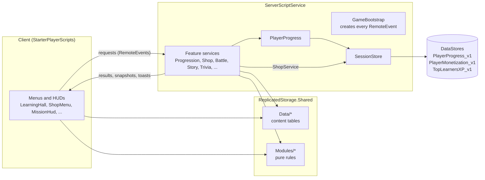

# Path of the Sahabah

[](https://github.com/Fahadbin-Alam/roblox-islamic-game/actions/workflows/checks.yml)

An educational Roblox game, written in Luau, where players aged 9 to 17 learn Islamic history and the basics of the faith by playing: they walk a hub modelled on Makkah and Madinah, follow the stories of the Companions (the Sahabah), take short lessons with quizzes, and play guided, age-appropriate versions of the battles of Badr and Uhud.

**Stack:** Luau (`--!strict`), Roblox Studio, [Rojo](https://rojo.space) for syncing files into Studio, DataStoreService and OrderedDataStore for saved data, MarketplaceService for purchases, GitHub Actions for tests, type checking and linting.

## What the game teaches

| Area | Content | Where it lives |
| --- | --- | --- |
| Islamic Studies hall | 30 lessons in 7 units: the Five Pillars, how to pray (wudu and the steps of salah), daily duas, the six articles of iman, stories of the Prophets, the Seerah, the Eids and special days. Each lesson ends with a quiz the server grades; some add an order puzzle. | `Shared/Data/IslamicStudies.lua` |
| Companion stories | Abu Bakr as-Siddiq, Bilal ibn Rabah, Mus'ab ibn Umayr, Nusaybah bint Ka'b and Umar ibn al-Khattab, told as short quests with a narrator and guides. | `Shared/Data/CompanionStories.lua` |
| Battle missions | Badr and Uhud as co-op story missions (objectives, waves, cited narration cards, a reflection quiz) plus a team skirmish mode. | `Shared/Data/BattleMissions.lua`, `BattleScenarios.lua` |
| Manners court | Truthfulness, respect for parents and elders, mercy, keeping promises, good speech. | `Shared/Data/MannersLessons.lua` |
| Daily loop | One cited ayah or hadith reflection and one review question per UTC day, with a visit streak. | `Shared/Data/DailyReflections.lua`, `Shared/Modules/Daily.lua` |
| Trivia court and study circle | A timed multiplayer trivia round, and a group quiz where everyone at the podium passes or fails together. | `TriviaService`, `StudyCircleService` |

Content rules the code follows: no Prophet is ever shown, voiced or playable (they appear only in narration); soldiers are generic and unnamed; rulings that differ between schools of thought stay general; daily reflections and battle narration cards carry a Qur'an or hadith reference, and lessons name their sources in the text; sacred places are treated with respect and monetization screens are kept away from the Kaaba.

## Features

- **Hub world** built in code (`HubWorldBuilder`), with a teleport menu, guide teachers who point to the next quest, a rideable camel and fall protection.
- **Progression**: XP, levels, rank titles, 23 badges, a 9-step suggested path with quest bonuses, free outfits at levels 3, 6 and 10, and level tags above players' heads.
- **Top Learners board**: a cross-server top-10 by XP in an OrderedDataStore.
- **Battles**: server-driven NPC soldiers (pathfinding, telegraphed swings, arrows with gravity), up to 3 stars per mission.
- **Shop**: cosmetic battle skins (game passes or level unlocks), developer products, and a Robux receipt handler that never loses or double-grants a purchase.
- **Mobile support**: `ResponsiveUi.client.lua` scales fixed-size panels to fit phone screens.

## Architecture

Rojo maps three folders in `src/` onto the Roblox data model (`default.project.json`):

```
src/
  ReplicatedStorage/Shared/      -> ReplicatedStorage.Shared (server and client)
    Config/                      game settings, animation ids
    Data/                        content: lessons, stories, missions, shop catalog (no answer keys)
    Modules/                     pure rules: Progression, Daily, MissionRules, ContentIndex
  ServerScriptService/           -> ServerScriptService (server only)
    *.server.lua                 one service per feature (Progression, Shop, Battle, Story, ...)
    Modules/                     PlayerProgress, SessionStore, Receipts, MissionDirector, BattleNpc, ...
                                 answer keys: LessonAnswers, ReflectionAnswers, TriviaQuestions
  StarterPlayer/StarterPlayerScripts/ -> client UI and HUD scripts (*.client.lua)
```



- **Shared** modules have no Roblox service calls, so the same rules run on the client (to display) and on the server (to decide), and they are unit tested outside Studio.
- **Server** is the only authority. `GameBootstrap.server.lua` creates every RemoteEvent under `ReplicatedStorage.Remotes`; each feature service listens on its own folder.
- **Client** scripts only draw UI and send requests. They never decide rewards.

### Server-authoritative design

The client is treated as untrusted. Every remote handler checks argument types and looks ids up in server-side tables before acting. Quizzes, order puzzles, battle reflections, trivia, study circles and the daily question are graded on the server, and the answer keys never leave it: everything in `ReplicatedStorage` is readable by any client, so the shared lesson and mission files hold only prompts and choices, while the keys live in `ServerScriptService/Modules` (`LessonAnswers.lua`, `ReflectionAnswers.lua`, `TriviaQuestions.lua`). The client sends the index it chose; `Modules/LessonGrading.lua` checks it is a whole number within the options, grades it against the key, and only then sends back the right answer and explanation. Trivia options are shuffled each round, and tests fail if a key drifts from its questions; story and trail steps advance only through ProximityPrompts (which Roblox range-checks); combat damage is computed on the server from Tool activation, not from client-reported hits. Quiz and puzzle submissions are rate-limited, replay XP for the same activity is paid at most once every 2 minutes, and profile requests are capped per player.

### How player data is saved

| DataStore | Contents | Owner |
| --- | --- | --- |
| `PlayerProgress_v1` | XP, completions, badges, stats | `Modules/PlayerProgress.lua` |
| `PlayerMonetization_v1` | equipped skin, ultimate charges, tokens, support points, recent PurchaseIds | `ShopService.server.lua` |
| `TopLearnersXP_v1` (ordered) | best XP per player, only ever goes up | `LeaderboardService.server.lua` |

Both player stores go through `Modules/SessionStore.lua`:

1. **Load** uses `UpdateAsync` to read the record and stamp it with a session lock (`JobId`, a unique session id, a timestamp). If another server still holds a fresh lock (the player just hopped servers), the load waits for that server's final save, then takes over. A lock older than 30 minutes is treated as a crashed server and taken at once.
2. **Save** uses `UpdateAsync` and only writes while the record still carries this session's id, so a server that lost the lock can never overwrite newer data. Saves for one player are queued, so an older snapshot cannot land after a newer one.
3. Every DataStore call is wrapped in `pcall` and retried with exponential backoff (1 s, 2 s, 4 s).
4. **Autosave** runs every 2 minutes (only when something changed) and refreshes the lock at least every 10 minutes. **PlayerRemoving** does a final save and releases the lock. **BindToClose** releases everyone left and waits for every final save in flight.
5. If a load fails, the player keeps playing with a fresh profile that is **never saved**, so an outage cannot wipe real progress, and they see a warning.

Robux purchases (`Modules/Receipts.lua`, wired up by `ShopService`): `ProcessReceipt` adds the grant and its `PurchaseId` to the player's monetization record in a single save, and returns `PurchaseGranted` only after that save succeeds. If the save fails, the grant is undone and Roblox retries the receipt later; if the PurchaseId is already in the record, the receipt is acknowledged without granting again; and a repeat call for a receipt whose save is still in flight waits (`NotProcessedYet`). `tests/luau/receipts.spec.luau` covers each of these cases.

## Getting started

Requirements: Roblox Studio, [Rojo 7.4](https://github.com/rojo-rbx/rojo/releases/tag/v7.4.4) (CLI and Studio plugin).

```bash
# Build a place file from the source
rojo build default.project.json -o build.rbxlx

# Or live-sync into an open Studio place (Windows helper: start-rojo-serve.ps1)
rojo serve default.project.json
```

`src/` is the source of truth. The committed `build.rbxlx` (and `build_next.rbxlx`) are older builds that no longer match `src/`; in particular they still carry the answer keys in `ReplicatedStorage`. Run `rojo build` before opening or publishing a place file, never publish the committed one as is, and either commit a fresh build with each change or (better) stop committing place files: delete them, add `*.rbxlx` to `.gitignore`, and let CI build one. The `tests/verify_*.ps1` scripts read `build.rbxlx`, so build it first (or pass `-BuildPath`).

Open the place in Studio (or connect the Rojo plugin) and press Play. To test saving in Studio, enable **Game Settings > Security > Enable Studio Access to API Services**; without it the game runs normally and simply does not save.

Run the same checks as CI locally (Linux or macOS; download the tools listed in `.github/workflows/checks.yml`):

```bash
tests/luau/run.sh path/to/luau          # unit tests
tests/world/run.sh path/to/luau         # battle arena layout checks
tests/analyze.sh path/to/luau-lsp path/to/rojo path/to/globalTypes.d.luau
selene --allow-warnings src             # lint
```

Interview notes on the design decisions and known weak spots: [docs/INTERVIEW-NOTES.md](docs/INTERVIEW-NOTES.md). Design document: [docs/game-foundation.md](docs/game-foundation.md). Monetization setup: [docs/monetization-setup.md](docs/monetization-setup.md).

## Progression And Islamic Studies

- `src/ReplicatedStorage/Shared/Data/IslamicStudies.lua` holds the Islamic Studies units: the Five Pillars, how to pray (wudu and the steps of salah), daily duas, the six articles of iman, stories of the Prophets and the Seerah told through narration only, and the Eids and special days. Every lesson ends with a checkpoint quiz that the server grades against `ServerScriptService/Modules/LessonAnswers.lua`.
- `src/ReplicatedStorage/Shared/Modules/Progression.lua` holds the rules: XP per activity, the level curve, rank titles, and badges.
- `src/ServerScriptService/Modules/PlayerProgress.lua` saves each player's XP, completions, badges, and stats to the `PlayerProgress_v1` DataStore. Other server scripts call `PlayerProgress.RecordCompletion(player, category, id, name)` when a player finishes a story, battle, lesson, learning walk, or manners lesson.
- Players open the hall from the `Learn` button or the Islamic Studies podium in the Trivia Court. The `My Journal` tab shows level, stats, and badges.
- The Islamic Studies podium in the Trivia Court also starts a study circle: everyone standing nearby answers one lesson's quiz together and passes or fails as a group (`StudyCircleService.server.lua`).
- The Battle of Uhud unlocks after the Battle of Badr or at level 3 (`Unlock` in `BattleScenarios.lua`).
- Daily return loop (`Shared/Modules/Daily.lua`, `Shared/Data/DailyReflections.lua`): each UTC day brings one cited reflection and one review question in the hall's **Today** tab, and a visit streak that grows the daily visit XP for up to a week.
- A suggested path (`Progression.Path`) powers the "Next" hint under the level bar and the checklist in **My Journal**.
- Finishing a path step is a quest: it pays a small XP bonus once. Three guide teachers (`Data/Guides.lua`, built by `GuideService`) stand at the Kaaba spawn, the Trivia Court, and the Story Court. Talking to one shows the next quest and a button that teleports the player there or opens the right lesson. The guides are present-day teachers, never historical figures.
- Level and XP show in the Roblox player list (leaderstats), and the **Top Learners** board beside spawn ranks the top 10 by XP across all servers (`LeaderboardService`, OrderedDataStore `TopLearnersXP_v1`). Profiles that failed to load never post a score.
- Some lessons end with an **order puzzle** (`Order` in `IslamicStudies.lua`, steps listed alphabetically; the right order is in `LessonAnswers.lua`): put the steps of wudu or salah, the Prophets, or Seerah events back in order. The server grades it (`SubmitOrder`) and pays XP once per puzzle; solving all of them earns the "In The Right Order" badge.
- Each player's level and rank title float above their head in the hub (`RankTagService`).
- Three battle outfits unlock for free at levels 3, 6, and 10 (`UnlockType = "Level"` in `ShopCatalog.lua`); equip them from the Shop.
- `ResponsiveUi.client.lua` shrinks fixed-size menus so they fit on phone screens.
- To also award real Roblox badges, create them in Creator Hub and set `RobloxBadgeId` on the matching badge in `Progression.lua`.

## Battle Story Missions

The battle gates offer two modes: **Story Mission** (co-op, 1 to 8 players) and **Team Skirmish** (the original PvP mode).

- `Shared/Data/BattleMissions.lua` defines each mission as a list of objectives (reach, hold, defend, defeat, discipline, narration), the enemy waves and lanes, the allied soldiers, and cited narration cards between steps.
- **Badr**: march to the wells, hold them, the rain falls (Qur'an 8:11), defend the banner through three waves, face the Makkan captain, then show mercy to the captives.
- **Uhud**: take position on the Archers' Hill, cover the army, then hold your post while the spoils tempt you. Allied archers leave their post as the historical archers did, and if players leave too, the cavalry flank arrives in force. The mission ends with the climb to the mountain and the regrouping.
- `ServerScriptService/Modules/BattleNpc.lua` runs the soldiers: R6 rigs with walk and attack animations, telegraphed sword swings, arrows with gravity, formations, and pathfinding when they get stuck. `MissionDirector.lua` runs the objectives, waves, respawns, and the HUD state.
- Missions earn up to 3 stars (complete, keep the steadfast goal, few falls) and end with a reflection quiz graded on the server. New badges: three stars at Badr and at Uhud, "Kept the Post", "Lessons of the Battles", and "Battle Veteran".
- Soldiers are generic and unnamed. The Prophet ﷺ and the Companions are never shown, and named historical figures appear only in narration.

Content added to `IslamicStudies.lua` should cite its Qur'an or hadith source, stay general where schools of thought differ, and never depict a Prophet. A new quiz question needs a matching entry (`CorrectIndex`, `Explanation`) in `LessonAnswers.lua`; the unit tests and the server's startup check fail if one is missing.

## Automated Checks

`.github/workflows/checks.yml` runs on every pull request:

- `tests/luau/run.sh <luau>` runs unit tests for the shared data and progression rules outside Studio, plus `SessionStore` against an in-memory DataStore (server hops, lock takeover, retries, outages), the receipt handler (`Receipts`) against a fake save, and the answer keys and grading (`answers.spec.luau`: no answers in replicated files, keys line up with questions, invalid choices rejected).
- `tests/analyze.sh <luau-lsp> <rojo> <globalTypes.d.luau>` type-checks every script against the Roblox API and fails on syntax errors, unknown globals, and broken requires.
- `tests/world/run.sh <luau>` builds the battle arenas against a mock Roblox engine and checks that every mission point has ground, every enemy lane and player route can be walked, and no spawn is inside rock.
- `selene --allow-warnings src` lints with the Roblox standard library (`selene.toml`); errors fail the build.

## Next Build Steps

1. Run `rojo build default.project.json -o build.rbxlx`, open it in Roblox Studio, and playtest the generated hub, story prompts, battle gates, manners court, shop, and teleport menu.
2. Replace placeholder product and ad placement IDs in `ShopCatalog.lua` with real Creator Hub IDs.
3. Publish the experience from Studio and enable the Roblox monetization settings described in `docs/monetization-setup.md`.
4. Add a longer Studio QA pass for mobile UI, battle pacing, and sacred-location review before public release.
